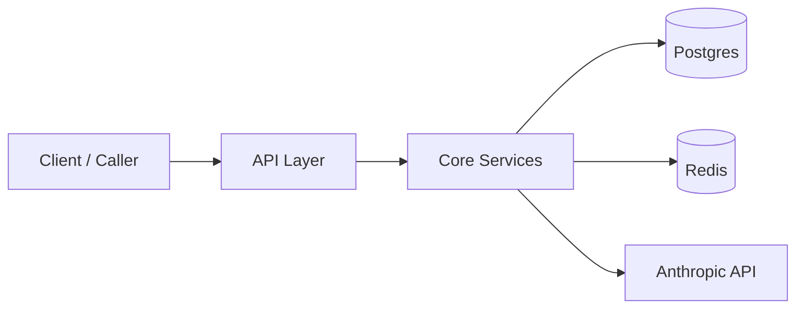
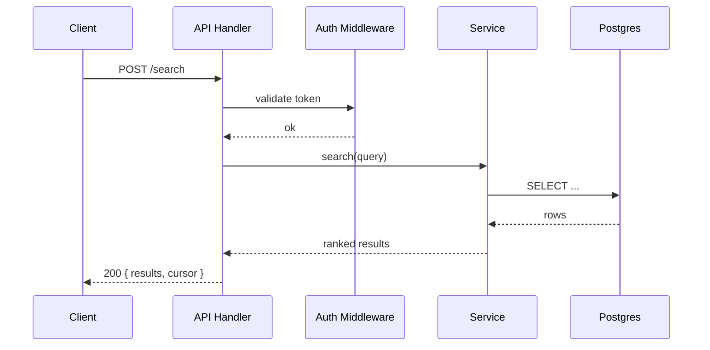
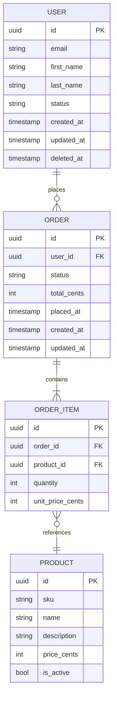
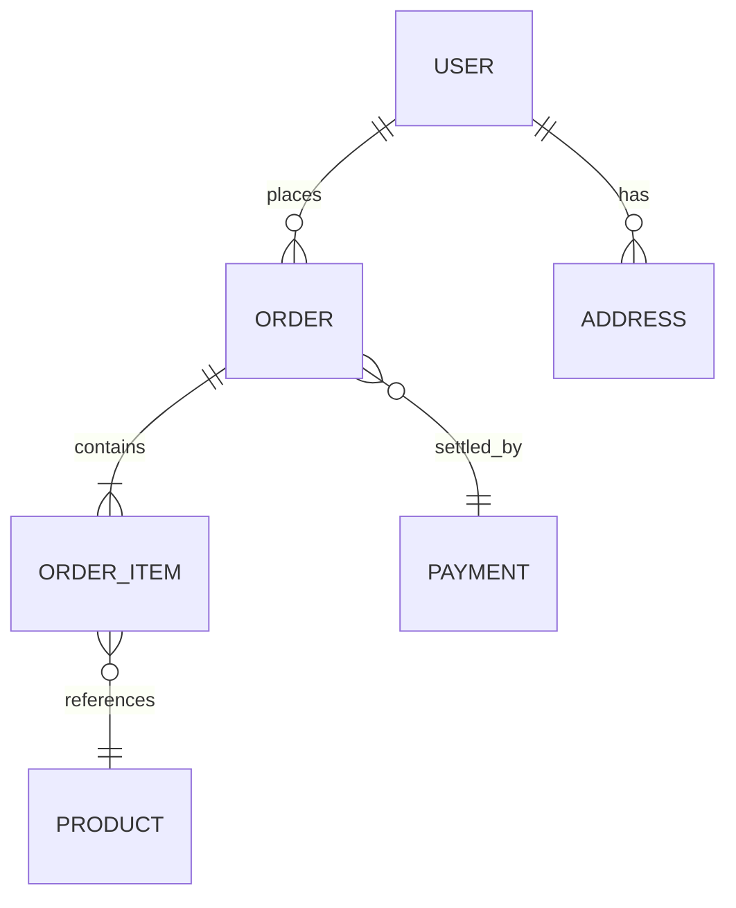
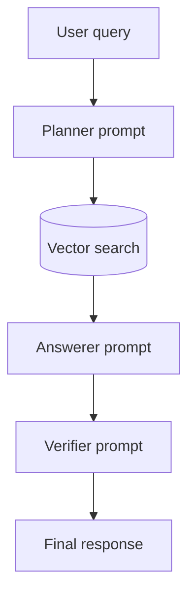

# Mermaid diagrams

Three diagram types cover almost everything you need: `flowchart` for architecture, `sequenceDiagram` for request lifecycles, and `erDiagram` for database layouts.

## The multi-diagram rule

**When a system or aspect is complex, generate multiple diagrams — one simplified high-level diagram first, then one or more focused breakdowns of the most important subsystem.**

Concrete heuristics:
- If a single diagram has more than ~12 nodes, split it.
- If it has more than 3 distinct layers (e.g., client → API → service → data → external), draw the high-level layer diagram and a separate focused diagram for any layer that has its own internal complexity.
- Don't try to capture every microservice the org has — only the ones this repo touches.

A reader can hold ~7 things in their head from a single diagram. A bloated diagram with everything on it is worse than two focused diagrams that each tell a clear story.

## Flowchart — high-level architecture

Use this for the main "Architecture" diagram. Show layers + key external touchpoints. Don't draw every internal module — pick the load-bearing ones.



If the repo has a request lifecycle worth showing in detail (auth → rate-limit → handler → service → response), use a second diagram — `sequenceDiagram` is often clearer for that than another flowchart.

## sequenceDiagram — request lifecycle

Use when the order of operations is the important thing.



Skip middleware that's purely standard (CORS, body-parser, request-id) unless it's load-bearing.

## erDiagram — database layout

Use for the Database section. The database section is special — the reader needs the *complete* schema picture, not a curated subset. Render **every entity in the schema** and **every column on each entity**, including all relationships. The wiki itself should be sufficient for the reader to understand the full layout without opening the schema file.



### Large schemas: pair a simplified diagram with the full one

If the schema is large (more than ~12 entities), render **two** erDiagrams, in this order:

1. **Simplified diagram first** — every entity name and the relationship lines, with **no field details**. This gives the reader the shape of the schema at a glance.
2. **Full diagram second** — every entity, every column, every relationship. This is the source-of-truth diagram.

Both are shown; the simple one orients, the full one is the reference. **Do not** drop tables from either diagram or relegate them to a footnote.

Example simplified diagram (no fields):



## flowchart — LLM pipeline

Use for the LLM flow section. Show the prompts as boxes and the data flow between them.



If the pipeline branches (e.g., different prompts for different intents), show the branch points. If it loops (agentic with retries), show the loop with an arrow back.

## Anti-examples

**Bad — kitchen sink architecture diagram:**
```
flowchart LR
    LB --> NGINX --> Express --> Auth --> RateLimit --> CORS --> BodyParser --> Router
    Router --> UserController & ProductController & OrderController & PaymentController & ...
    UserController --> UserService --> UserRepo --> Postgres
    ProductController --> ProductService --> ProductRepo --> Postgres
    ...
```
Why it's bad: too many nodes, low signal, the reader can't tell what matters. Either draw the layers (`Client → API → Service → DB`) or zoom into one slice — not both at once.

**Good — split into high-level + focused:**

High-level (6 nodes):
```
Client → API → ServiceLayer → Postgres
                          → Redis
                          → AnthropicAPI
```

Focused on `ServiceLayer` (8 nodes):
```
ServiceLayer split:
    SearchService → Ranker → Postgres
                         → AnthropicAPI (rerank prompt)
    OrderService → InventoryClient → ExternalInventoryAPI
                → PaymentClient → Stripe
```
Why it's good: the high-level fits in one glance; the focused diagram only loads when the reader cares about the service layer specifically.
