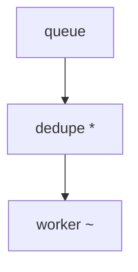
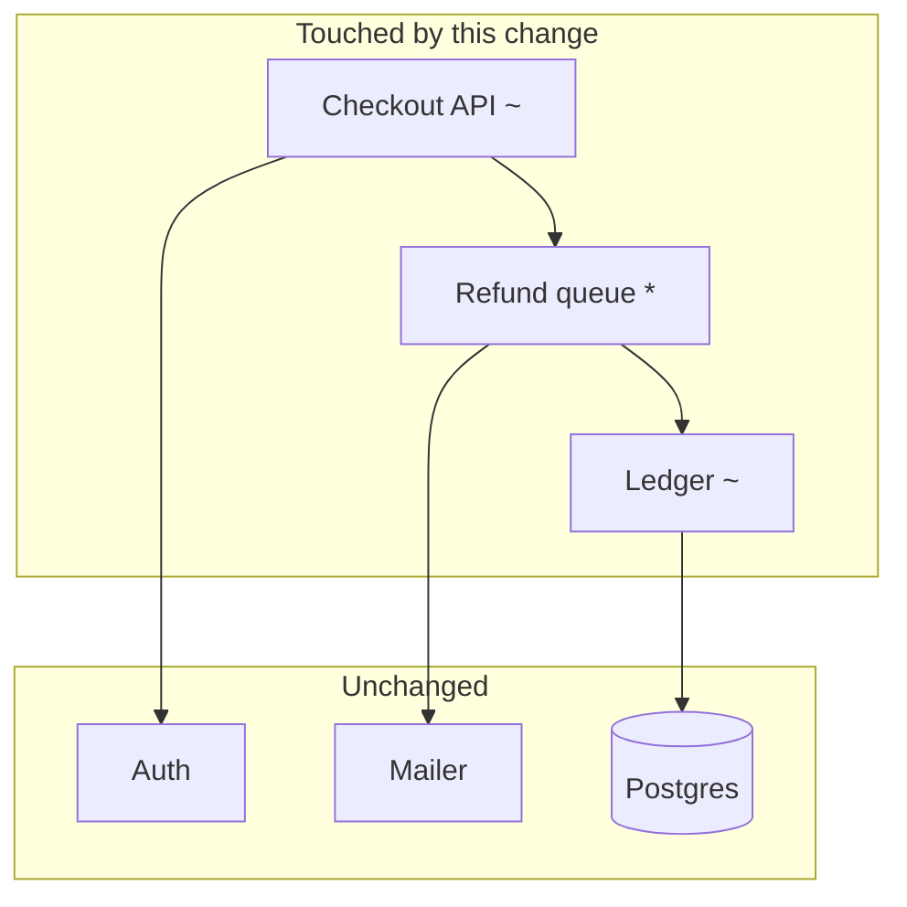
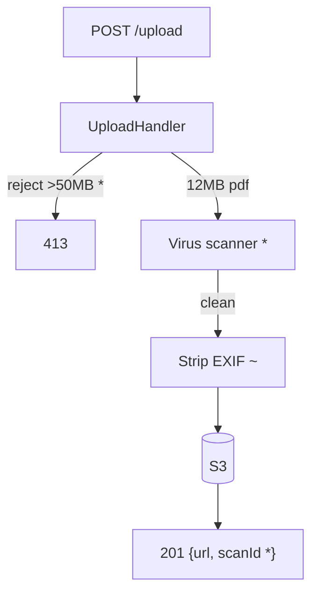
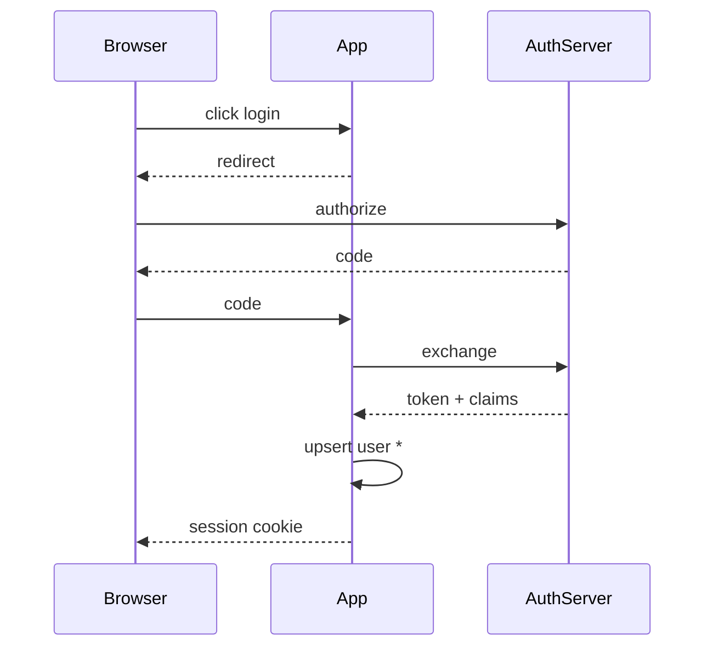
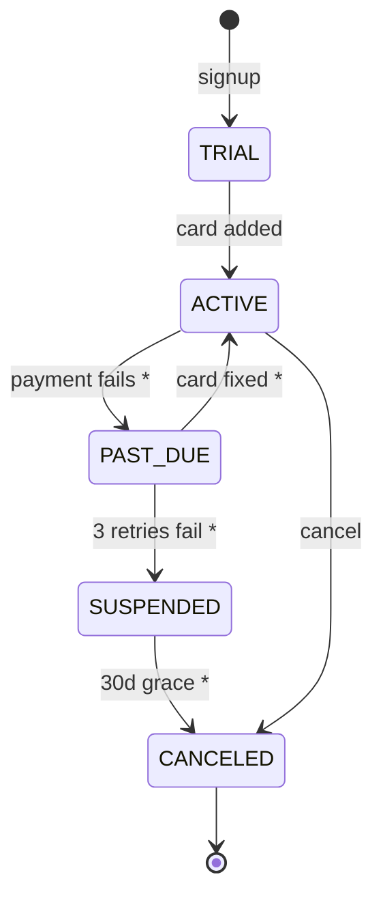
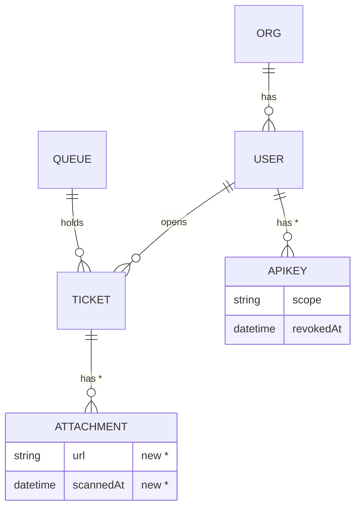

# Diagram recipes

**Everything is mermaid.** The doc is read in VS Code's markdown preview, which renders
```mermaid fences natively. Never hand-draw ASCII box art — it is not a fallback, it is
not an option, and a mangled ASCII sketch is exactly the wall of characters this skill
exists to prevent.

The examples below are deliberately drawn from **different, unrelated domains** — they
teach the *shape*, not the subject. Never copy an example's nouns into your output.
Every node, arrow, and number must come from the code in front of you.

## Marking the change

Put the marker **in the node label**, and caption the diagram with the legend:


`* new  ~ changed  x removed`

---

## Choosing

| The change is about... | Draw a... | Mermaid |
|---|---|---|
| Which systems this touches at all (≥3 systems) | **System map** | `flowchart TD` |
| A request/job moving through layers | **Pipeline** | `flowchart TD` |
| Two+ services/actors talking over time | **Sequence** | `sequenceDiagram` |
| Something with modes (draft/live/archived) | **State machine** | `stateDiagram-v2` |
| Tables, records, relationships | **Entity map** | `erDiagram` |
| A quantity that moved (latency, retries, cost) | **Chart** | `xychart-beta` |
| Same input, different output than before | **Before/after** | markdown table |

`flowchart TD` (top-down) by default. `LR` becomes an unreadable ribbon past ~5 nodes.

---

## System map — the entry point for multi-system changes

**Lead with this whenever the change touches 3+ systems.** It is the reader's index:
here is the whole board, here is the part that moved. Keep it dumb and small — no
detail, just which boxes are involved and which ones this change lit up.


`* new  ~ changed`

Then one diagram per flow below it. The map tells them where each flow lives.

---

## Pipeline

Data or control moving through stages. *Example domain: file upload.*


`* new  ~ changed`

Keep it to ≤8 nodes. Label arrows with *what travels*, not the method name.

---

## Sequence

When ordering and round-trips are the point. *Example domain: OAuth login.*


`* new`

The win is showing **which round-trip was added or removed**.

---

## State machine

Anything with a status column. *Example domain: a subscription.*


`* new`

Always draw the **old** states too — the reader needs to see what got bolted on.

---

## Entity map

Schema / model changes. *Example domain: a helpdesk.*


`* new` — mention dropped tables/columns in a caption bullet; `erDiagram` can't show them.

---

## Chart — a quantity that moved

For thresholds, latencies, retry counts, costs. *Example domain: retry backoff.*

```mermaid
xychart-beta
  title "Seconds waited before retry N"
  x-axis "attempt" [1, 2, 3, 4, 5]
  y-axis "seconds" 0 --> 16
  bar [1, 1, 1, 1, 1]
  bar [1, 2, 4, 8, 16]
```


- Series 1 = old `fixed(1s)` — 5s total, all five hammer at once.
- Series 2 = new `exp(2^n) *` — 31s total. **Callers must raise their timeout.**

Charts need a caption naming the series; `xychart-beta` has no legend. Anchor the old
value and the new value, and say what it costs.

---

## Before / after — a markdown table, not a diagram

When behaviour changed but structure didn't. *Example domain: a search endpoint.*

| | Before | After |
|---|---|---|
| Lookup | `LIKE '%term%'` scan | inverted index |
| Cost | O(n) over 2M rows | O(log n) |
| p95 | 900ms | ~12ms |
| Typos | no tolerance | fuzzy, edit distance 2 `*` |

Same rows, two columns. The reader's eye does the diffing. This is the one "diagram"
that isn't mermaid — a table renders natively and beats a drawing here.

---

## Craft notes

- **Quote every label with spaces or punctuation** — `B["retry (2^n) *"]`. Unquoted
  parens, colons, and `>` are the usual parse break. You cannot see the render; don't
  get clever.
- **≤15 nodes per diagram.** More than that and you're drawing the codebase, not the change.
- **One diagram, one idea.** If you're tempted to add a subgraph to squeeze in another
  flow, that flow deserves its own diagram.
- **Label arrows with data**, not function names: `12MB pdf` > `handleUpload()`.
- **The diagram must carry the change.** If you could draw the same picture before and
  after the commit, you drew the wrong thing.
- **Real names, real numbers**, pulled from the diff. `ServiceA → ServiceB` is a diagram
  of nothing.
