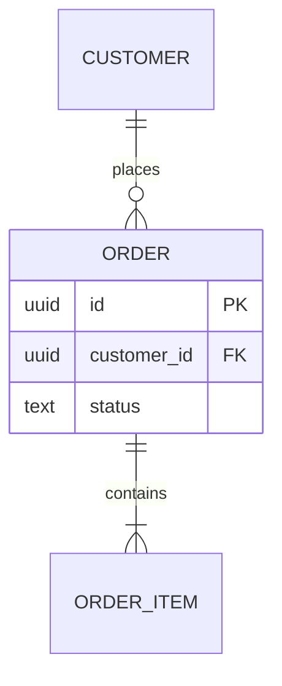
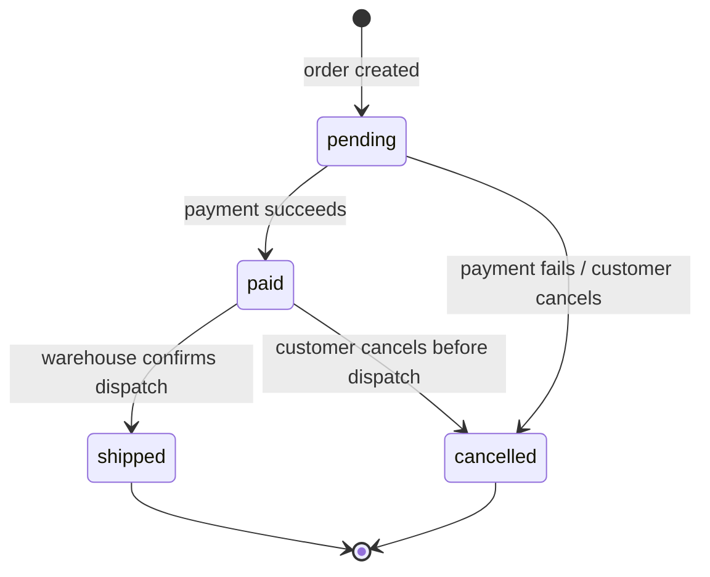

# Data model

How a spec defines tables, columns, allowed values, and state. Every new or
changed entity gets an ER diagram entry, a column table, and (if it has a
status) a state diagram.

## Prefer the smallest change

In brownfield work, read the existing schema (migrations, ORM models, schema
files) first.

| Situation | Choice |
|---|---|
| The new data belongs to an existing entity, one value per row | Add a column to the existing table |
| A one-to-many or many-to-many relationship | New table with a foreign key |
| The data has its own lifecycle, status, or owner | New table |
| Adding columns would make most of them null for most rows | New table |
| An existing table is very large or hot, and the change needs a rewrite | New table, or the expand-contract steps below |

Pick whichever is the smaller change and adds less complexity, and say why in
one line.

## ER diagram

A Mermaid `erDiagram` with every new or changed entity and the existing
entities they relate to. Show keys and relationships. Leave full column detail
to the tables below, so the diagram stays readable.

Mark changed entities in the text under the diagram ("`ORDER` is existing;
adds `cancelled_at` and `cancellation_reason`").

## Column tables

One table per new or changed entity. For a changed entity, list only new or
changed columns and say so.

**`orders`** (existing, 2 new columns)

| Column | Type | Null | Default | Allowed values | Meaning |
|---|---|---|---|---|---|
| `status` | `text` | no | `'pending'` | `pending`, `paid`, `shipped`, `cancelled` | Where the order is in its lifecycle. See state diagram |
| `cancelled_at` | `timestamptz` | yes | `null` | Set only when `status = 'cancelled'` | When the order was cancelled |
| `cancellation_reason` | `text` | yes | `null` | `customer_request`, `payment_failed`, `out_of_stock` | Why it was cancelled. Required when `cancelled_at` is set |

Rules for the table:
- **Allowed values** is never blank. Use a list for enums, a range for numbers
  (`1 to 100`), a format for strings (`ISO 4217 code`, `E.164 phone`), a rule
  for conditional columns ("set only when ..."), or `any` when truly
  unconstrained.
- **Meaning** says what the value represents, not the type again.
- State how each rule is enforced: database constraint (`CHECK`, `NOT NULL`,
  foreign key, enum type), application code, or both. Prefer database
  constraints for rules that must never break.
- Money: integer minor units plus a currency column. Times: timezone-aware UTC.
- Sensitive columns (PII, secrets, tokens): mark them and state retention and
  who can read them.

## Enum values

For each enum, list every value and its meaning, once, in the column table or
a short table under it if meanings need more than a few words. Same values,
same spelling in the database, the API, and the code (see
[`types-naming.md`](types-naming.md)).

## State diagrams

Every status, state, or lifecycle column gets a Mermaid `stateDiagram-v2`.

For each state, check and write down:
- **What moves it on**: the event, job, or user action on each arrow.
- **What happens on failure or a crash** between setting the state and the
  next step. Does a job retry it, does a timeout move it, or does it stay
  stuck?
- **How a stuck row is cleared**: a retry job, a timeout, an admin action.
  "Edit the database by hand" is not an answer; add a path or list it as an
  open question.
- **Which transitions are not allowed**, and what the API returns when someone
  tries one (usually `409`).

## Indexes

Add an index only for a query the spec actually introduces, and name the query:
"index on `(customer_id, created_at)` for `GET /v1/customers/{id}/orders`
sorted by newest". Unique constraints that enforce a rule always count.

## Migrations (brownfield)

For changes to existing tables with live data, use expand-contract so old and
new code can run at the same time during a deploy:

1. **Expand**: add the new column or table, nullable or with a default. No
   reads depend on it yet.
2. **Migrate**: write to both old and new; backfill existing rows in batches.
3. **Switch**: read from the new shape.
4. **Contract**: stop writing the old shape, then drop it in a later release.

In the spec:
- Say which steps apply, and which stage each lands in.
- Flag operations that lock or rewrite a large table (adding a non-null column
  without a default on some databases, changing a column type, adding an index
  without `CONCURRENTLY` on Postgres) and the safe alternative.
- State whether each migration can be rolled back.
