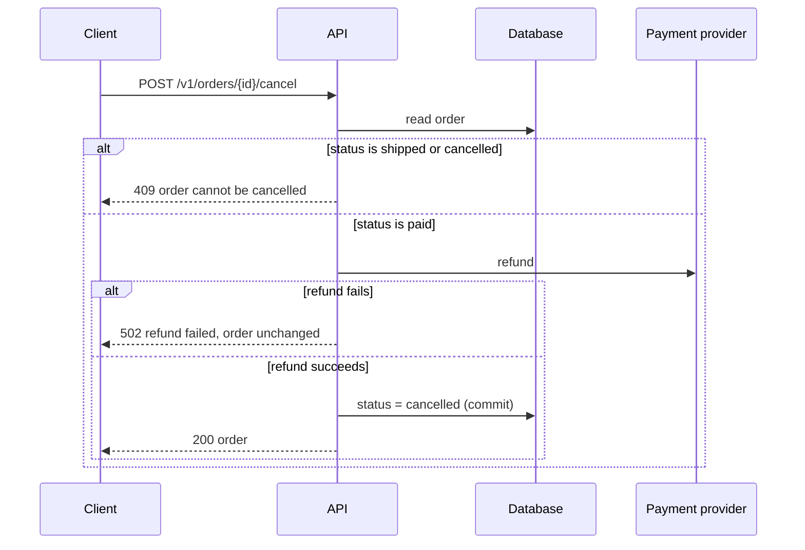

# Flows

How a spec shows behavior. Diagrams and tables carry the flow; text adds only
what they can't show (a reason, a timing rule, a constraint).

## Which diagram

| What you're showing | Diagram |
|---|---|
| Calls between actors over time (client, API, worker, database, third party) | `sequenceDiagram` |
| A decision rule, gating logic, or a step-by-step process | `flowchart` |
| The lifecycle of a status column | `stateDiagram-v2` (see [`data.md`](data.md)) |
| How the parts of the system connect | `flowchart LR` architecture diagram |

## Which flows get a diagram

- Every flow a user or caller starts that touches more than two actors.
- Every background job, webhook, or scheduled task the spec adds.
- Every decision rule with more than two branches.
- Skip a diagram for a plain read or a single insert. A row in the endpoint
  table covers it.

## Sequence diagrams

- One diagram per flow, named for what the user or caller does ("Cancel an
  order"), not for the code.
- Participants are the real parts: browser, API, worker, queue, database,
  named third parties.
- Label calls with the contract name: `POST /v1/orders/{id}/cancel`, the queue
  or event name, the table written.
- **Show failure paths** with `alt` or `opt` blocks: the third party times
  out, validation fails, the state is already final, the worker crashes after
  the write but before the event. Each shows what the caller sees.
- Show where the transaction commits, and whether events or side effects
  happen before or after it.

## Flowcharts

- Use for rules, not for call order. Each diamond is one yes/no or one value
  check.
- Every branch ends somewhere: an outcome, an error, or another named flow.
- If the rule is a lookup (input → output), a table is clearer than a
  flowchart.

## Text around diagrams

Bullets under a diagram, only for:
- timing (timeouts, retry counts and backoff, poll intervals);
- ordering guarantees, or the lack of them;
- idempotency (what happens if the same request or event arrives twice);
- anything a reader would get wrong from the diagram alone.

Don't narrate the diagram step by step.

## Size

- Keep a diagram to about 7 to 12 nodes or participants. Past that, draw a
  high-level diagram first, then one focused diagram per busy part.
- One idea per diagram.
